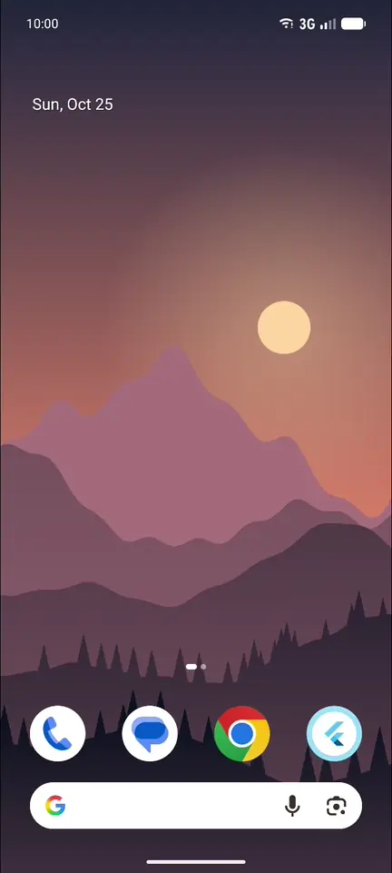
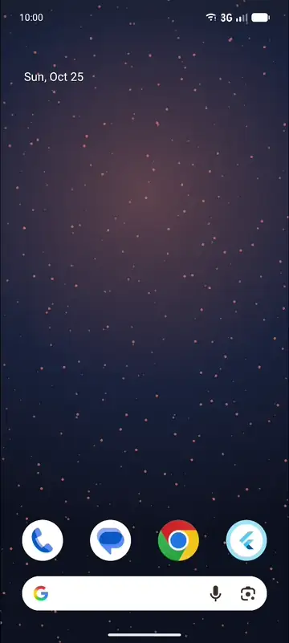
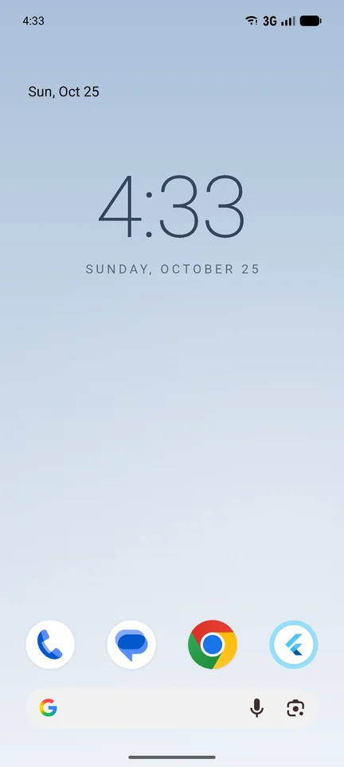

# wallflower: Flutter live wallpapers for Android

Build an Android live wallpaper from ordinary Flutter widgets: animated scenes, parallax that
follows home screen swipes and device tilt, and tap effects.

<p align="center">
  
  
  
</p>

Other wallpaper packages set an image, a video or a shader. wallflower runs your widget tree *as*
the live wallpaper: Android's wallpaper service starts a Flutter engine that draws straight to the
wallpaper, so an animated wallpaper is just a widget.

## Features

- **Any widget as the wallpaper**, drawn by the same renderer as your app.
- **Parallax** that follows home screen swipes and **device tilt**.
- **Taps and launcher zoom**: pointer events, taps on empty home screen space, and the zoom as
  the app drawer opens.
- **Settings from your app**, which the running wallpaper sees immediately, and messages both
  ways.
- **Material You**: the system theme and status bar follow the scene's colors.
- **Home screen, lock screen or both**, and the system picker's preview.
- **`SafeArea` and `MediaQuery`** report the system bars, display cutouts and rounded corners.
- **Battery-aware**: no frames while the wallpaper is hidden, and no motion sensor unless
  something reads tilt.
- **Fails safe**: if the Flutter engine can't start, the wallpaper draws a solid color instead of
  crashing, so Android doesn't reset it.

## Requirements

- Android 7.0 (API 24) or later. iOS has no live wallpaper API.
- Flutter 3.44 or later.

## Quick start

These steps turn a Flutter app into a live wallpaper. The
[Getting started](https://github.com/sharpsan/wallflower/blob/main/doc/getting-started.md) guide
walks through them in more detail.

**1. Add the package:**

```sh
flutter pub add wallflower
```

**2. Declare the wallpaper** in `android/app/src/main/AndroidManifest.xml`. Add `<uses-feature>`
inside `<manifest>`, and `<service>` inside `<application>`:

```xml
<manifest xmlns:android="http://schemas.android.com/apk/res/android">
    <uses-feature android:name="android.software.live_wallpaper" android:required="false" />

    <application ...>
        <activity ...>...</activity>

        <service
            android:name="app.sharpsan.wallflower.FlutterWallpaperService"
            android:label="@string/wallpaper_label"
            android:permission="android.permission.BIND_WALLPAPER"
            android:exported="true">
            <intent-filter>
                <action android:name="android.service.wallpaper.WallpaperService" />
            </intent-filter>
            <meta-data android:name="android.service.wallpaper" android:resource="@xml/wallpaper" />
            <meta-data android:name="wallflower.entrypoint" android:value="wallpaperMain" />
        </service>
    </application>
</manifest>
```

**3. Describe it for the wallpaper picker** in `android/app/src/main/res/xml/wallpaper.xml`:

```xml
<wallpaper xmlns:android="http://schemas.android.com/apk/res/android"
    android:description="@string/wallpaper_description"
    android:thumbnail="@mipmap/ic_launcher" />
```

and `android/app/src/main/res/values/strings.xml`:

```xml
<resources>
    <string name="wallpaper_label">My wallpaper</string>
    <string name="wallpaper_description">A live wallpaper made with Flutter.</string>
</resources>
```

**4. Write the wallpaper.** Replace `lib/main.dart` with:

```dart
// lib/main.dart
import 'package:flutter/material.dart';
import 'package:wallflower/wallflower.dart';

/// The app: a button that opens the system's wallpaper preview.
void main() => runApp(const MyApp());

/// The wallpaper. Its name matches the `wallflower.entrypoint` meta-data.
@pragma('vm:entry-point')
void wallpaperMain() => runWallpaper(const MyScene());

class MyScene extends StatelessWidget {
  const MyScene({super.key});

  @override
  Widget build(BuildContext context) {
    // 0 on the first home screen page, 1 on the last.
    final page = Wallpaper.pageOffsetOf(context).dx;
    return ColoredBox(color: Color.lerp(Colors.indigo, Colors.orange, page)!);
  }
}

class MyApp extends StatelessWidget {
  const MyApp({super.key});

  @override
  Widget build(BuildContext context) {
    return const MaterialApp(
      home: Scaffold(
        body: Center(
          child: FilledButton(
            onPressed: LiveWallpaper.openPicker,
            child: Text('Set as wallpaper'),
          ),
        ),
      ),
    );
  }
}
```

`@pragma('vm:entry-point')` keeps `wallpaperMain` in release builds, since no Dart code calls it.

**5. Run it** with `flutter run`, tap **Set as wallpaper**, and apply the wallpaper. Swipe between
home screen pages and the color shifts. Debug builds take a few seconds to show the wallpaper;
release builds show it at once.

## How it works

Your app now has two entrypoints. `main` runs the app as usual. `wallpaperMain` runs whenever the
wallpaper is applied, even while the app is closed: in the app's process, but in a Flutter engine
and Dart isolate of its own. The system picker's preview runs another copy.

The app and the wallpaper share code but not state: a static field set in the app isn't set in the
wallpaper. The app passes settings to the wallpaper through a saved config, and the two can send
each other messages.

## Learn more

Guides, step by step with complete code:

- [Getting started](https://github.com/sharpsan/wallflower/blob/main/doc/getting-started.md):
  from `flutter create` to a wallpaper on your home screen, and a quick way to work on a scene.
- [Writing scenes](https://github.com/sharpsan/wallflower/blob/main/doc/scenes.md): parallax,
  launcher zoom, visibility and battery, the lock screen, and Material You colors.
- [Motion and touch](https://github.com/sharpsan/wallflower/blob/main/doc/motion-and-touch.md):
  device tilt, taps and launcher commands.
- [The app and the wallpaper](https://github.com/sharpsan/wallflower/blob/main/doc/app-and-wallpaper.md):
  settings, messages, and several wallpapers in one app.
- [Testing and previews](https://github.com/sharpsan/wallflower/blob/main/doc/testing.md): widget
  tests, and showing a scene inside your app.

The [example](https://github.com/sharpsan/wallflower/tree/main/example) is the wallpaper in the
screenshots above: parallax mountains, particles that ripple where you tap, and a clock, with a
settings app that switches between them.

## API overview

### Wallpaper state

`runWallpaper` runs a widget the way `runApp` does, without a `MaterialApp` above it; add one
inside the scene if it needs Material widgets or themes. Read the wallpaper's state the way you
read `MediaQuery`:

| Method | Returns |
|---|---|
| `Wallpaper.visibleOf(context)` | Whether the wallpaper is on screen. Frames stop while it's hidden. |
| `Wallpaper.pageOffsetOf(context)` | The launcher's scroll position across home screen pages, 0 to 1. |
| `Wallpaper.zoomOf(context)` | 0 normally, toward 1 as the launcher zooms out for the app drawer or recents. |
| `Wallpaper.isPreviewOf(context)` | Whether this is the system picker's preview. |
| `Wallpaper.targetOf(context)` | Home screen, lock screen or both (Android 14 and later). |
| `Wallpaper.configOf(context)` | The settings the app saved. |

Each method rebuilds the widget only when its own value changes (`pageOffsetOf` also when the
page step does). `Wallpaper.of(context)` returns everything as one `WallpaperData`.

Any widget can be the scene, including Flame's `GameWidget`. Code outside the widget tree, such as
a game loop, can use `Wallpaper.data` and `WallpaperTilt.listenable`; pause it while the wallpaper
is hidden.

### Tilt

```dart
final tilt = WallpaperTilt.of(context); // Offset, each axis -1 to 1
```

Tilt is measured from the way the phone is held, and drifts back to zero when the phone settles at
a new angle. `WallpaperTilt.settings` tunes the sampling rate, smoothing, re-centering and range.

The motion sensor runs while the wallpaper is visible and something reads tilt: a mounted widget
that has called `WallpaperTilt.of`, or a listener on `WallpaperTilt.listenable`. A widget counts
until it unmounts, so read tilt in a small widget of its own and leave that widget out when the
scene doesn't need tilt.

### Taps

Touches arrive as ordinary pointer events, so `GestureDetector` and `Listener` work. Launchers also
send commands on `Wallpaper.commands`, such as `WallpaperCommand.tap` for a tap on empty home
screen space. Command positions can be a few percent off, so for precision, pair a command with
the pointer event from the same tap.

### Settings and messages

```dart
// In the app:
await LiveWallpaper.setConfig({'scene': 'aurora', 'speed': 2}); // saved, and sent to the wallpaper
await LiveWallpaper.send('celebrate');                          // one-off message
LiveWallpaper.messages.listen((message) => debugPrint(message.name));

// In the wallpaper:
final config = Wallpaper.configOf(context); // {'scene': 'aurora', 'speed': 2}
Wallpaper.messages.listen((message) { /* 'celebrate' */ });
await Wallpaper.sendToApp('done', data: {'frames': 120});
```

The config is a JSON-compatible map, saved on the device. Messages reach only the wallpapers and
app screens running at the time.

`LiveWallpaper.isActive()` says whether the wallpaper is applied. For apps that offer several
wallpapers, every `LiveWallpaper` method takes an optional `service:`.

### Material You colors

```dart
await Wallpaper.reportColors(
  const Color(0xFFE8876B),
  secondary: const Color(0xFF1B2340),
  supportsDarkTheme: true,
);
```

Android derives the system theme from these colors when the user's theme follows the wallpaper.
`supportsDarkText` switches the status bar and Pixel Launcher to dark text and icons. Report only
when the colors change, since each report makes the system recompute its theme.

### Previews and tests

`WallpaperScope` provides made-up wallpaper state to a scene, to show it inside your app or to
drive it in widget tests:

```dart
final data = ValueNotifier(const WallpaperData(visible: true, pageStep: Offset(0.25, 0)));

WallpaperScope(data: data, child: const MyScene());

data.value = data.value.copyWith(pageOffset: const Offset(0.5, 0)); // "swipe" to page 3
```

## Battery

A live wallpaper is on screen whenever the home screen is, so its cost adds up.

- **Hidden wallpapers draw nothing**, but Dart timers and streams keep running. Pause them while
  `Wallpaper.visibleOf(context)` is false.
- **Prefer animations that settle.** A scene that changes only on swipes, tilt or taps draws no
  frames in between. On a Pixel 10 Pro, a static scene used 0.1% of a CPU core while visible, and
  a simple gradient animating at 60 fps used about a third of a core.
- **Read tilt only when you use it.** While the phone lies still, the sensor drops to 10 samples a
  second, and a static scene reading tilt used under 1% of a core on the same phone.

## Troubleshooting

- **The wallpaper stays black.** Check logcat for the tag `Wallflower`, which warns if no frame
  arrives within 5 seconds of the wallpaper becoming visible. Usually the entrypoint's name doesn't
  match the meta-data, the function lacks `@pragma('vm:entry-point')`, or it doesn't call
  `runWallpaper`. It must also be in `lib/main.dart`, unless the `wallflower.entrypointLibrary`
  meta-data names its file.
- **The first frame is slow.** Debug builds start the wallpaper in JIT mode, which takes seconds.
  In profile and release builds on a Pixel 10 Pro, the first frame appeared 30–110 ms after the
  wallpaper's surface did.
- **The wallpaper reset to the system default.** Android removes a live wallpaper when its app is
  force-stopped, uninstalled, or crashes repeatedly. `flutter run` force-stops the app when it
  starts and when you quit with `q`; detach with `d` instead. Updating the app any other way keeps
  the wallpaper.
- **Tilt stays at zero.** Tilt measures movement away from how the phone is held, so it returns to
  zero whenever the phone is still. Devices and emulators without a motion sensor always report
  zero.

## Limitations

- Android only.
- Plugins are registered in the wallpaper's engine too, but plugins that need an `Activity` won't
  get one.
- No platform views, text input or accessibility semantics inside the wallpaper.
- Each running engine costs memory, mostly GPU buffers for the full-screen surface. On a Pixel 10
  Pro, a simple animated scene's process used about 185 MB (PSS, about 100 MB of it graphics), and
  about 75 MB more while the picker preview was open.
- Flutter keeps about half a megabyte of native memory per engine after the engine shuts down. It
  adds up only if the picker preview is opened many times without the process restarting.
